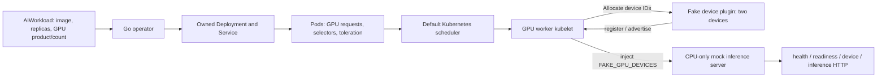
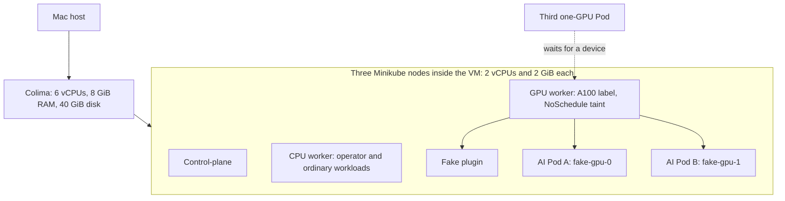

# GPU Node Selector

**Ten-day MVP complete; final acceptance and cleanup verified on 30 October 2026.** The project cluster was destroyed after testing to release runtime resources. Follow Build and run below to recreate it.

Learn how Kubernetes runs workloads that compete for a limited device resource. This project lets you request a GPU product and count through an `AIWorkload` resource, then observe placement, allocation, capacity exhaustion, updates and recovery on a laptop.

The Kubernetes control plane and device allocation are real. The GPUs and inference computation are simulated: two fake device IDs, no NVIDIA hardware, CUDA, model downloads or external AI API. This makes the system inexpensive to reproduce while keeping the scheduling and reconciliation problems visible.

## How it works



The operator expresses desired state and repairs drift. The scheduler selects an eligible node and accounts for requests. The kubelet owns device allocation and release. Keeping these responsibilities separate avoids an operator-side GPU counter that could race with other workloads.



The node budgets are nested inside the VM, not added to its host memory budget. CPU numbers are fixed. A GPU product selector chooses eligible hardware; a resource request accounts for consumption; a taint keeps ordinary Pods off the GPU worker unless they explicitly tolerate it. Each has a different job.

## Why these choices

| Choice | Reason and tradeoff |
| --- | --- |
| CRD + operator | A small declarative API owns Deployment/Service state and reports observed progress. Reconciliation is idempotent and preserves unrelated metadata. |
| Default scheduler | Reuses Kubernetes placement/resource accounting. Excess demand remains Pending; replicas are never silently capped. |
| Fake device plugin | Exercises registration, allocation and restart without GPU hardware. It proves device identity, not GPU performance. |
| Zero-surge rollout | With both devices occupied, an old replica must release a device before its replacement can run. One-replica updates can interrupt service. |
| OwnerReferences | Kubernetes garbage-collects children after CR deletion. No external resources require a custom finalizer. |
| Named local profiles | Operations target this project explicitly. No global Docker prune or deletion of unrelated clusters. |

## Build and run

Use macOS with Homebrew and Command Line Tools. The tested host is ARM64 with 10 CPUs and 16 GiB RAM. Exact versions and portability limits are in [toolchain](docs/toolchain.md).

```sh
cd /Users/dhirajsriharsha/Preparation/GpuNodeSelector
make tools doctor
make cluster-up
make cluster-configure
make docker-build minikube-load install deploy
make demo
```

`tools` installs missing prerequisites without unrelated upgrades. Image build and load are separate because Colima Docker and each Minikube node's containerd have different stores. `deploy` installs the operator and plugin in `ai-system`. Run only one manager; do not also run `make run`.

`make demo` is the full acceptance walkthrough: two allocated Pods, excess demand, scale-down/reuse, HTTP responses, saturated image update, isolation, drift, stable reapply, zero replicas, failed requests, collisions and deletion. It uses temporary namespaces and cleans them, leaving the platform available. It requires both devices to be free initially. `make demo-smoke` runs only the shorter integration subset. Evidence is saved under ignored `work/`.

For a persistent sample you can inspect yourself:

```sh
kubectl --context gpu-node-selector create namespace ai-workloads
kubectl --context gpu-node-selector apply -f config/samples/ai_v1alpha1_aiworkload.yaml
kubectl --context gpu-node-selector -n ai-workloads wait --for=condition=Ready aiworkload/mock-llama --timeout=180s
kubectl --context gpu-node-selector -n ai-workloads get aiworkloads,pods -o wide
kubectl --context gpu-node-selector -n ai-workloads port-forward service/mock-llama 8080:8080
# In another terminal:
curl http://localhost:8080/device
curl -H 'Content-Type: application/json' -d '{"prompt":"hello"}' http://localhost:8080/inference
```

If `ai-workloads` already exists, inspect it and reuse it intentionally; do not delete someone else's namespace. Stop port-forward with Ctrl-C. Remove your sample before automated demos: `kubectl --context gpu-node-selector -n ai-workloads delete aiworkload mock-llama`. Wait for its Pods to disappear.

At three replicas, two run and one waits. Scheduler messages on this topology combine GPU shortage with selector mismatch on the other nodes, so `Pending / MultipleSchedulingConstraints` is correct. Only capacity-only evidence produces `CapacityBlocked / InsufficientGPU`. Status always needs a matching observed generation; an old Ready condition is not proof that a new spec has converged.

## Verify and recover

```sh
make verify
make e2e-recovery
make lifecycle-check
```

`verify` runs format checks, vet, unit tests, builds, generated-file reproducibility, envtest, race checks, shell guard tests, image/security/RBAC audit and real-cluster E2E. Missing prerequisites fail explicitly. `e2e-recovery` additionally restarts the operator, plugin and only the validated GPU-worker kubelet; it verifies fresh allocation and reuse. `lifecycle-check` stops/restarts the project VM and checks object identities and stored data survive; it requires no existing AIWorkloads. Run these commands sequentially. On the tested Mac, the existing linker mismatch requires `SDKROOT=/Library/Developer/CommandLineTools/SDKs/MacOSX15.4.sdk make verify`. Use a working SDK appropriate to your host, rather than assuming that path exists everywhere.

## Stop or completely remove the cluster

| Command | CPU and RAM | Disk and cluster data |
| --- | --- | --- |
| `make cluster-down` | Stops project nodes and the VM; releases runtime CPU/RAM use | Preserves profiles, images and Kubernetes data for restart |
| `make cluster-up` | Starts the existing VM/nodes | Reuses preserved state; follow with `make deploy` and `make demo` |
| `make cluster-destroy CONFIRM=gpu-node-selector` | Removes the VM; no project VM CPU/RAM use remains | Deletes this Minikube cluster, Colima VM **and runtime data disk**, images/volumes inside it and project contexts |

CPU cores are not permanently reserved after shutdown. Destroy is irreversible for cluster data, is safe to repeat, and checks ownership before deletion. It retains source, planning documents, `work/` evidence, `bin/`, installed host tools and shared download caches. These retained files do not keep a VM running. It never runs global prune, deletes all profiles, or edits ProjectMsgQueue. Recreate after destruction using the full build/run sequence above.

## Read more and completion evidence

- [Architecture](docs/architecture.md), [API](docs/api.md), [reconciliation](docs/reconciliation.md), [status](docs/status-and-failures.md), [device plugin](docs/fake-device-plugin.md).
- [Local lifecycle](docs/local-cluster.md), [demo details](docs/demo.md), [E2E coverage](tests/e2e/README.md), [troubleshooting](docs/troubleshooting.md).
- [Design decisions](docs/adr/0001-default-scheduler.md), [rollout/ownership decision](docs/adr/0004-owned-fields-and-rollouts.md), [final handoff](docs/planning/days/day-10.md), [progress](docs/planning/progress.md).

Native ARM64 execution is tested. AMD64 images were cross-built; AMD64 runtime is not claimed. There is no real GPU compute, autoscaling, telemetry, custom scheduler or production high-availability configuration. Future extensions could add real-device integration and availability engineering after measuring their requirements.

The [original requirements](docs/planning/original-project-prompt.txt) and [ten-day plan](docs/planning/implementation-plan.md) are preserved. For future work, read [persistent context](docs/planning/project-context.md) and the latest handoff before changing code.
