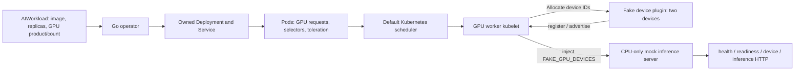
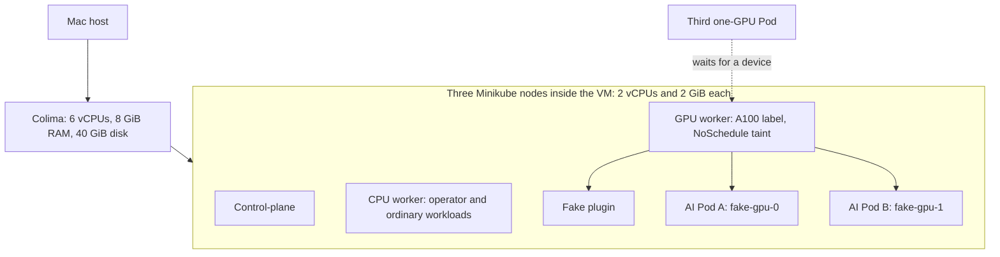

# GPU Node Selector

GPU Node Selector is a Kubernetes operator for declarative GPU workloads. Submit an `AIWorkload` with a container image, replica count, GPU product and GPU count per replica. The operator maintains its Deployment and Service, while Kubernetes schedules Pods and allocates devices. A local fake GPU plugin and mock Llama inference server make placement, capacity exhaustion, updates and recovery reproducible on a laptop.

The Kubernetes control plane and device allocation are real. The GPUs and inference computation are simulated: two fake device IDs by default, no NVIDIA hardware, CUDA, model downloads or external AI API. This makes the system inexpensive to reproduce while keeping the scheduling and reconciliation problems visible.

## How it works



The operator expresses desired state and repairs drift. The scheduler selects an eligible node and accounts for requests. The kubelet owns device allocation and release. Keeping these responsibilities separate avoids an operator-side GPU counter that could race with other workloads.



The node budgets are nested inside the VM, not added to its host memory budget. CPU numbers are fixed. A GPU product selector chooses eligible hardware; a resource request accounts for consumption; a taint keeps ordinary Pods off the GPU worker unless they explicitly tolerate it. Each has a different job.

## Why these choices

| Choice | Reason and tradeoff |
| --- | --- |
| CRD + operator | A small declarative API owns Deployment/Service state and reports observed progress. Reconciliation is idempotent and preserves unrelated metadata. |
| Default scheduler | Reuses Kubernetes placement/resource accounting. Excess demand remains Pending; replicas are never silently capped. |
| Fake device plugin | Exercises registration, allocation and restart without GPU hardware. It proves device identity, not GPU performance. |
| Zero-surge rollout | With both devices occupied, an old replica must release a device before its replacement can run. One-replica updates can interrupt service. |
| OwnerReferences | Kubernetes garbage-collects children after CR deletion. No external resources require a custom finalizer. |
| Named local profiles | Operations target this project explicitly. No global Docker prune or deletion of unrelated clusters. |

## Install with Helm

Use macOS with Homebrew and Command Line Tools. The tested host is ARM64 with 10 CPUs and 16 GiB RAM. Exact versions and portability limits are in [toolchain](docs/toolchain.md).

Run these commands in order from the repository. This sequence assumes a new cluster or an existing Helm-managed platform. For an older kubectl-managed installation, follow the [migration instructions](docs/helm.md#upgrade-and-ownership); Helm deliberately refuses automatic adoption.

```sh
cd /Users/dhirajsriharsha/Preparation/GpuNodeSelector
make tools doctor
make cluster-up
make cluster-configure
make docker-build minikube-load
make helm-test
make helm-install
make helm-aiworkloads
make helm-verify
make helm-status
```

`tools` installs missing prerequisites without unrelated upgrades. Image build and load are separate because Colima Docker and each Minikube node's containerd have different stores. `helm-install` installs the CRD, operator and plugin in `ai-system`. `helm-aiworkloads` installs the mock Llama AIWorkload in `ai-workloads`; the operator creates its inference Deployment and Service. `helm-inference` is an alias for this workload installation, not a separate server. Run only one manager; do not also run `make run`.

`make demo` is the full acceptance walkthrough: two allocated Pods, excess demand, scale-down/reuse, HTTP responses, saturated image update, isolation, drift, stable reapply, zero replicas, failed requests, collisions and deletion. It uses temporary namespaces and cleans them, leaving the platform available. It requires both devices to be free initially. `make demo-smoke` runs only the shorter integration subset. Evidence is saved under ignored `work/`.

Inspect the persistent Helm sample and send a request:

```sh
make helm-status
kubectl --context gpu-node-selector -n ai-workloads get aiworkloads,pods -o wide
kubectl --context gpu-node-selector -n ai-workloads port-forward service/mock-llama 8080:8080
# In another terminal:
curl http://localhost:8080/device
curl -H 'Content-Type: application/json' -d '{"prompt":"hello"}' http://localhost:8080/inference
```

Stop port-forward with Ctrl-C. Before automated demos, remove the persistent sample with `make helm-aiworkloads-remove`; this waits for operator-created children to disappear. Then run `make demo`. Helm owns the AIWorkload; the operator owns its Deployment and Service. Never install both a manually managed and Helm-managed copy of the platform. See [Helm deployment](docs/helm.md) for values, capacity scenarios, upgrades, migration and removal.

At three replicas, two run and one waits. Scheduler messages on this topology combine GPU shortage with selector mismatch on the other nodes, so `Pending / MultipleSchedulingConstraints` is correct. Only capacity-only evidence produces `CapacityBlocked / InsufficientGPU`. Status always needs a matching observed generation; an old Ready condition is not proof that a new spec has converged.

The fake GPU count is configurable with `plugin.devices` in the platform chart (default **2**, supported range **1–256**). See [configuring fake GPU capacity](docs/helm.md#configuring-fake-gpu-capacity) for overrides and safe updates. Automated capacity/recovery scenarios below assume the default two devices.

## Helm command reference

| Command | What it does |
| --- | --- |
| `make helm-lint` | Lints both charts and checks that the packaged CRD matches its generated source; no cluster needed. |
| `make helm-test` | Runs lint plus rendering, configuration validation and manifest contract tests; no cluster needed. |
| `make helm-install` | Installs or upgrades the CRD/platform release in `ai-system`; waits for operator and plugin rollouts. Existing CRDs require explicit schema upgrades. |
| `make helm-aiworkloads` | Installs or upgrades the default `mock-llama` AIWorkload release in `ai-workloads`. |
| `make helm-inference` | Alias for `helm-aiworkloads`; do not install it as a separate server. |
| `make helm-verify` | Checks current-generation readiness, GPU placement and HTTP inference for the default workload release. |
| `make helm-status` | Shows the platform/default Helm releases and workload resources. |
| `make helm-aiworkloads-remove` | Removes the default workload release and waits for its operator-owned children to disappear. |
| `make helm-uninstall` | Removes the platform; refuses while AIWorkloads or GPU-consuming Pods remain. |
| `make helm-sync` | Refreshes the chart CRD after API changes; does not apply a live CRD upgrade. See the [CRD upgrade procedure](docs/helm.md#upgrade-and-ownership). |

To change workload settings, put them in a values file and apply it:

```sh
make helm-aiworkloads HELM_VALUES=/absolute/path/workload-values.yaml
make helm-verify
```

Helm release installation can succeed while an operator-created Pod remains Pending. Use `helm-verify` for the default workload and inspect custom workloads explicitly. The default status/removal wrappers do not manage additional Helm releases.

## Add an additional AIWorkload

After installing the platform and default workload above, run:

```sh
helm --kube-context gpu-node-selector upgrade --install mock-llama-extra \
  charts/aiworkloads \
  --namespace ai-workloads \
  --set name=mock-llama-extra \
  --set replicas=1

helm --kube-context gpu-node-selector list --namespace ai-workloads
kubectl --context gpu-node-selector -n ai-workloads get aiworkloads,pods -o wide
kubectl --context gpu-node-selector -n ai-workloads describe aiworkload mock-llama-extra
```

Use a unique release name and `name` value for each additional workload. With the default two GPUs already occupied by `mock-llama`, the extra replica should remain Pending. Inspect its actual Pod name from the output above:

```sh
EXTRA_POD=$(kubectl --context gpu-node-selector -n ai-workloads get pods -o json | \
  jq -r '.items[] | select(.metadata.annotations["ai.dhiraj.io/workload-name"]=="mock-llama-extra") | .metadata.name')
kubectl --context gpu-node-selector -n ai-workloads describe pod "$EXTRA_POD"
```

Look for `PodScheduled: False`, no assigned node, and a `FailedScheduling` event mentioning insufficient GPU capacity. The [recorded test result](#test-result-gpu-capacity-exhaustion-across-helm-workloads) below shows this outcome.

To demonstrate scheduling after a device is freed, reduce the default workload to one replica:

```sh
helm --kube-context gpu-node-selector upgrade mock-llama \
  charts/aiworkloads --namespace ai-workloads --set replicas=1
kubectl --context gpu-node-selector -n ai-workloads \
  wait --for=condition=Ready pod/"$EXTRA_POD" --timeout=180s
```

After removing the extra release using the cleanup steps below, run `make helm-aiworkloads` and `make helm-verify` to restore the default two-replica sample (assuming unchanged chart defaults).

## Change the fake GPU count

Remove GPU workloads first, using the workload cleanup steps below; keep the platform installed. Create an override file:

```sh
mkdir -p work
cat > work/platform-values.yaml <<'EOF'
plugin:
  devices: 4
EOF
make helm-install HELM_VALUES=work/platform-values.yaml
kubectl --context gpu-node-selector get nodes \
  -l ai.dhiraj.io/gpu-node=true \
  -o custom-columns='NAME:.metadata.name,CAPACITY:.status.capacity.ai\.dhiraj\.io/gpu,ALLOCATABLE:.status.allocatable.ai\.dhiraj\.io/gpu'
```

Wait for capacity and allocatable to show `4`, then reinstall your workloads. Capacity is shared across namespaces. Keep passing the platform override on later platform upgrades; do not pass this file to the workload chart. Before automated capacity/recovery tests, remove workloads again, restore the chart default to `2` if you edited it, and run `make helm-install` without the override. Confirm capacity is two before proceeding.

## Uninstall Helm workloads and platform

Keep the cluster running during Helm cleanup. Stop any port-forward with Ctrl-C. Remove application releases before removing the operator or plugin.

1. Remove the extra release (if installed):

   ```sh
   helm --kube-context gpu-node-selector uninstall mock-llama-extra \
     --namespace ai-workloads --ignore-not-found --wait --timeout 180s
   kubectl --context gpu-node-selector -n ai-workloads get aiworkloads,deployments,services,pods
   ```

   Wait for the extra workload's children, including its Pod, to disappear. Helm's release removal alone does not prove child garbage collection is complete. Repeat for any other additional releases, using their names and namespaces.

2. Remove the default workload and check for remaining consumers:

   ```sh
   make helm-aiworkloads-remove
   kubectl --context gpu-node-selector get aiworkloads -A
   kubectl --context gpu-node-selector -n ai-workloads get deployments,services,pods
   ```

   The Make target waits for the default workload's children. Check other namespaces too if you deployed workloads there. Stop here if you intend to run automated tests or deploy new workloads on the existing platform.

3. Remove the platform when no workloads remain:

   ```sh
   make helm-uninstall
   helm --kube-context gpu-node-selector list --namespace ai-system
   kubectl --context gpu-node-selector -n ai-system get deployments,daemonsets,pods
   ```

   The platform uninstall preserves the CRD and namespaces. It does not stop Colima or release its runtime CPU/RAM. Do not delete the CRD to remove an individual workload: deleting it removes every AIWorkload.

4. Choose `make cluster-down` to preserve the cluster on disk, or `make cluster-destroy CONFIRM=gpu-node-selector` to permanently delete it. See [cluster cleanup](#stop-or-completely-remove-the-cluster) below. Full cluster destruction also removes Helm releases; individual Helm uninstalls are not required if you are intentionally deleting the entire cluster.

## Verify and recover

First follow steps 1–2 of [Helm cleanup](#uninstall-helm-workloads-and-platform), including every additional release. Keep the platform installed and its GPU count at two. Then run:

```sh
make helm-aiworkloads-remove  # Safe to repeat; default release only
make verify
make e2e-recovery
make lifecycle-check
```

`verify` runs Helm lint/render tests, format checks, vet, unit tests, builds, generated-file reproducibility, envtest, race checks, shell guard tests, image/security/RBAC audit and real-cluster E2E. Missing prerequisites fail explicitly. `e2e-recovery` additionally restarts the operator, plugin and only the validated GPU-worker kubelet; it verifies fresh allocation and reuse. `lifecycle-check` stops/restarts the project VM and checks object identities and stored data survive; it requires no existing AIWorkloads. Run these commands sequentially. On the tested Mac, the existing linker mismatch requires `SDKROOT=/Library/Developer/CommandLineTools/SDKs/MacOSX15.4.sdk make verify`. Use a working SDK appropriate to your host, rather than assuming that path exists everywhere.

### Test result: GPU capacity exhaustion across Helm workloads

In a user-run cluster test, the Helm-managed `mock-llama` workload occupied both fake GPUs with two one-GPU replicas. A second Helm release, `mock-llama-extra`, requested one additional GPU:

```sh
helm --kube-context gpu-node-selector upgrade --install mock-llama-extra \
  charts/aiworkloads --namespace ai-workloads \
  --set name=mock-llama-extra --set replicas=1

kubectl --context gpu-node-selector -n ai-workloads get pods,deployments
kubectl --context gpu-node-selector -n ai-workloads \
  describe pod mock-llama-extra-84c858f57c-j82qz
```

Recorded output, excerpted from the test (Pod names will differ on another run):

```text
NAME                                   READY   STATUS
pod/mock-llama-7fc796857f-89f4k          1/1     Running
pod/mock-llama-7fc796857f-mxgps          1/1     Running
pod/mock-llama-extra-84c858f57c-j82qz    0/1     Pending

NAME                               READY   UP-TO-DATE   AVAILABLE
deployment.apps/mock-llama          2/2     2            2
deployment.apps/mock-llama-extra    0/1     1            0
```

The extra Pod had no assigned node and requested exactly one GPU:

```text
Node:          <none>
Status:        Pending
Limits:        ai.dhiraj.io/gpu: 1
Requests:      ai.dhiraj.io/gpu: 1
               cpu: 100m
               memory: 128Mi
PodScheduled:  False
Node-Selectors: ai.dhiraj.io/gpu-node=true
                ai.dhiraj.io/gpu-product=A100
Tolerations:    ai.dhiraj.io/gpu=true:NoSchedule
```

The scheduler reported:

```text
Warning  FailedScheduling  default-scheduler
0/3 nodes are available: 1 Insufficient ai.dhiraj.io/gpu,
2 node(s) didn't match Pod's node affinity/selector.
preemption: 0/3 nodes are available:
1 No preemption victims found for incoming pod,
2 Preemption is not helpful for scheduling.
```

**Result: the capacity-exhaustion test passed.** The existing two replicas stayed Running, while the extra replica remained Pending. The GPU worker had no free requested device, and the other two nodes did not match the GPU selectors. The operator created the requested Deployment and Service without reducing replicas; the default Kubernetes scheduler enforced capacity and placement constraints. This demonstrates scheduling with simulated devices, not real GPU computation. Scheduling and device reuse after freeing capacity are separate checks, not shown in this capture.

Follow the [ordered Helm cleanup steps](#uninstall-helm-workloads-and-platform) to remove the extra and default workload releases before running isolated acceptance tests.

## Stop or completely remove the cluster

| Command | CPU and RAM | Disk and cluster data |
| --- | --- | --- |
| `make cluster-down` | Stops project nodes and the VM; releases runtime CPU/RAM use | Preserves profiles, images and Kubernetes data for restart |
| `make cluster-up` | Starts the existing VM/nodes | Reuses preserved state; follow with `make helm-install` and `make helm-verify` if a Helm workload is installed |
| `make cluster-destroy CONFIRM=gpu-node-selector` | Removes the VM; no project VM CPU/RAM use remains | Deletes this Minikube cluster, Colima VM **and runtime data disk**, images/volumes inside it and project contexts |

CPU cores are not permanently reserved after shutdown. Destroy is irreversible for cluster data, is safe to repeat, and checks ownership before deletion. It retains source, planning documents, `work/` evidence, `bin/`, installed host tools and shared download caches. These retained files do not keep a VM running. It never runs global prune, deletes all profiles, or edits ProjectMsgQueue. Recreate after destruction using the full build/run sequence above.

## Documentation

- [Architecture](docs/architecture.md), [API](docs/api.md), [reconciliation](docs/reconciliation.md), [status](docs/status-and-failures.md), [device plugin](docs/fake-device-plugin.md).
- [Local lifecycle](docs/local-cluster.md), [demo details](docs/demo.md), [E2E coverage](tests/e2e/README.md), [troubleshooting](docs/troubleshooting.md).
- [Helm deployment](docs/helm.md), [design decisions](docs/adr/0001-default-scheduler.md), [rollout/ownership decision](docs/adr/0004-owned-fields-and-rollouts.md).

Native ARM64 execution is tested. AMD64 images were cross-built; AMD64 runtime is not claimed. There is no real GPU compute, autoscaling, telemetry, custom scheduler or production high-availability configuration. Future extensions could add real-device integration and availability engineering after measuring their requirements.

## Implementation history

The [original requirements](docs/planning/original-project-prompt.txt) and [ten-day plan](docs/planning/implementation-plan.md) are preserved. For future work, read [persistent context](docs/planning/project-context.md) and the latest handoff before changing code.
