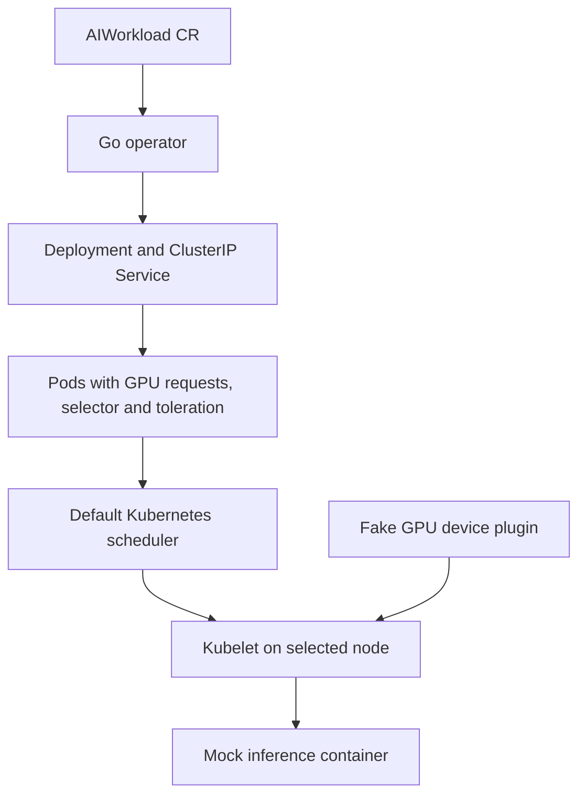

# Architecture

Status: Day 1 design accepted; runtime components are implemented in later milestones.

Go module: `github.com/Dhiraj1729/GpuNodeSelector`. This is the chosen local module identity; no remote repository has been created or published.

The operator expresses desired state. It creates and owns one Deployment and Service, repairs fields it owns, preserves unrelated metadata and allocated Service fields, and reports generation-aware status. It never sets `nodeName`, binds Pods, reserves/counts GPUs for placement, caps replicas to capacity, or labels/taints nodes.

The default scheduler accounts for integer `ai.dhiraj.io/gpu` requests alongside product selectors and taints. The kubelet obtains fake device IDs from the plugin and injects `FAKE_GPU_DEVICES` into the mock container. Bootstrap labels/taints the GPU worker and deploys the plugin. Labels alone cannot account for consumption; taints keep ordinary workloads without a toleration off the dedicated worker.

AIWorkload API is namespaced `ai.dhiraj.io/v1alpha1`. It specifies image, replicas, port, GPU product/count and optional CPU/memory requests. Native quantities and metav1.Condition are used. See [the API and reconciliation contract](planning/technical-design.md) for field validation, owned-field policy, status precedence and tests.

Reconciliation is event-driven and idempotent: fetch, validate, build desired children, reject ownership collisions, merge managed fields, inspect observed children/Pods, and patch semantic status changes only. OwnerReferences provide garbage collection in a real cluster; no external cleanup obligation means no finalizer. A zero-surge rollout with maxUnavailable=1 frees a GPU before starting a replacement; single-replica updates can interrupt service.

The fake plugin implements registration, ListAndWatch and Allocate, with two healthy IDs. It validates duplicate IDs within a request but permits later RPC retries; kubelet owns allocation lifetime. It simulates resource allocation only, not GPU compute or CUDA. The mock provides health/readiness/device/inference endpoints without external dependencies.

The MVP excludes real GPU drivers, CUDA, real models, telemetry, autoscaling, custom scheduling, DRA, fractional GPUs and multi-cluster management. These can be discussed as future extensions, not dependencies of this project.

## Toolchain

See [the Day 1 toolchain record](toolchain.md). No application `go.mod` or API scaffold has been added to source yet. A disposable scaffold under ignored `work/day-01/` was used only to inspect the installed generator's dependency defaults.
